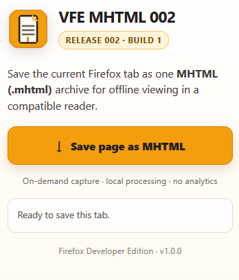

# VFE MHTML 002

A small Firefox extension that saves the active tab as one complete MHTML (.mhtml) file.

<p align="center">
  
</p>

## Download and install (unsigned)

1. Use **Firefox Developer Edition**, Nightly, or a compatible ESR build. Tested target: Firefox Developer Edition 160.0b1 (64-bit); runtime testing is still required.
2. Open `about:config` and set `xpinstall.signatures.required` to `false`.
3. Open `about:addons` → gear icon → **Install Add-on From File**.
4. Select `VFE-MHTML-002-Firefox.xpi` from Releases.
5. Open an ordinary HTTP(S) page, click the add-on icon, then **Save page as MHTML**. Select a destination in the Save As dialog.

For temporary development use `about:debugging#/runtime/this-firefox` → **Load Temporary Add-on** → select `manifest.json`.

## What it does

- Only runs after you click Save; uses `activeTab` and `downloads`, no permanent host permissions.
- Clones the current top-level page; snapshots form values and canvas when allowed, removes scripts and CSP metadata.
- Fetches accessible images, stylesheets, fonts and other linked resources up to **250 resources / 40 MiB** and emits a MIME multipart/related `.mhtml` archive.
- Safe title + UTC timestamp filenames and Save As dialog; local-only processing, no telemetry, remote scripts or third-party dependencies.
- Uses the exact VFE 001 **color palette** and a closely matched replacement icon. Original PNG assets were not available to copy when this build was prepared.

Firefox itself may not open `.mhtml` natively. Open with a compatible MHTML reader (often Chromium-based browsers). No guarantee of pixel-perfect offline fidelity.

## Build release locally

```bash
python3 scripts/build.py
```

Creates an unsigned XPI in `dist/` from the root extension files. Python 3 only, no install dependencies. Only the XPI should be installed; the repo ZIP contains documentation and tooling.

## Project layout

- `manifest.json`, `background.js`, `capture.js` — Firefox add-on
- `popup.html`, `popup.css`, `popup.js` — user interface
- `icons/` — PNG assets
- `scripts/build.py` — deterministic unsigned XPI generator
- `PRIVACY.md`, `SECURITY.md`, `CHANGELOG.md`, `LICENSE` — publication documents

MIT License. Copyright (c) 2026 Flavius.
